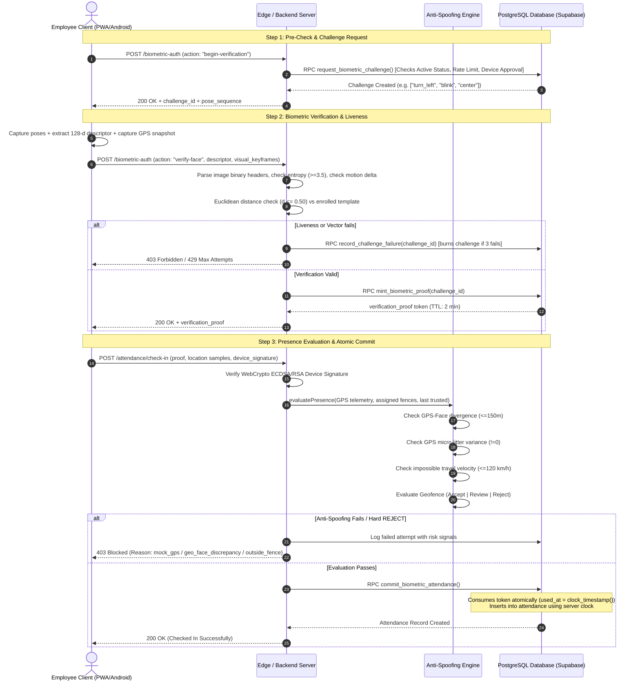

# Complete Attendance, Biometric Face Verification, GPS Geofencing & Anti-Spoofing Architecture Guide

> **System:** Enterprise HR & Workforce Attendance System (PWA & Android Integration)  
> **Security Model:** Zero-Trust Defense-in-Depth Pipeline  
> **Timezone:** `Africa/Cairo` (UTC+2 / UTC+3 DST)  
> **Status:** Production-Hardened Specification (v5)

---

## Table of Contents
1. [End-to-End Architectural Overview](#1-end-to-end-architectural-overview)
2. [Biometric Face Verification & Active Liveness Pipeline](#2-biometric-face-verification--active-liveness-pipeline)
   - [2.1 AI Model & Vector Embeddings](#21-ai-model--vector-embeddings)
   - [2.2 Active Liveness Challenge Engine](#22-active-liveness-challenge-engine)
   - [2.3 Visual Keyframe & Binary Security Parsing](#23-visual-keyframe--binary-security-parsing)
   - [2.4 Vector Matching & Verification Proof Minting](#24-vector-matching--verification-proof-minting)
3. [GPS Geofencing & Spatial Presence Engine](#3-gps-geofencing--spatial-presence-engine)
   - [3.1 Haversine Distance Geometry](#31-haversine-distance-geometry)
   - [3.2 Three-Tier Boundary Uncertainty Resolution](#32-three-tier-boundary-uncertainty-resolution)
4. [Anti-Spoofing & Fraud Detection Engine (Fake Avoiding)](#4-anti-spoofing--fraud-detection-engine-fake-avoiding)
   - [4.1 Synthetic & Mock GPS Detection (Micro-Jitter Variance)](#41-synthetic--mock-gps-detection-micro-jitter-variance)
   - [4.2 Cryptographic Face-Location Divergence](#42-cryptographic-face-location-divergence)
   - [4.3 Physical Impossibility & Teleportation Detection](#43-physical-impossibility--teleportation-detection)
   - [4.4 Sensor Anomalies & Stale Fixes](#44-sensor-anomalies--stale-fixes)
   - [4.5 Device Binding & WebCrypto Digital Signatures](#45-device-binding--webcrypto-digital-signatures)
   - [4.6 Multi-Attempt Rate Limiting & High-Risk Lockout](#46-multi-attempt-rate-limiting--high-risk-lockout)
5. [Check-In & Check-Out Execution Lifecycle](#5-check-in--check-out-execution-lifecycle)
   - [5.1 Pre-Flight Policy Verification](#51-pre-flight-policy-verification)
   - [5.2 Atomic Token Consumption & Server Clock Timestamping](#52-atomic-token-consumption--server-clock-timestamping)
6. [Unified API Contract](#6-unified-api-contract)
7. [Database Schema & Stored Procedures (SQL)](#7-database-schema--stored-procedures-sql)
8. [Codebase Reference Matrix](#8-codebase-reference-matrix)

---

## 1. End-to-End Architectural Overview

The attendance system operates on the security premise that **browser-reported client signals are inherently untrusted**. True physical workplace presence cannot be proven by any single parameter; it is enforced via the intersection of independent cryptographic, biometric, temporal, and spatial vectors.



---

## 2. Biometric Face Verification & Active Liveness Pipeline

### 2.1 AI Model & Vector Embeddings
* **Backbone**: Modified ResNet-34 architecture (Dlib-compatible weights).
* **Embedding Dimension**: 128-dimensional normalized floating-point vector (`float32[128]`).
* **Enforced Integrity**:
  * All 128 numbers must be finite real floats (`Number.isFinite(v)`).
  * No `NaN`, `null`, `undefined`, or `Infinity` values permitted.
  * Vector norm $\|\mathbf{v}\|_2 \approx 1.0$.

### 2.2 Active Liveness Challenge Engine
To prevent static photo, video playback, and injected stream attacks, verification requires an interactive sequence:
1. **Dynamic Challenges**: Server randomly selects an action chain, such as:
   * `["turn_left", "blink", "center"]`
   * `["turn_right", "smile", "center"]`
   * `["nod", "blink", "turn_left"]`
2. **Interaction Timeline**:
   * Total challenge lifespan: **60 seconds**.
   * Frame timestamp delta constraint: $800\text{ ms} \le (t_{i} - t_{i-1}) \le 10{,}000\text{ ms}$.
   * Strictly monotonically increasing timestamps ($t_1 < t_2 < t_3$).

### 2.3 Visual Keyframe & Binary Security Parsing
Instead of blindly relying on client claims, the backend image parser (`verifyVisualKeyframesLiveness`) executes binary-level inspections:

1. **Format & Header Parsing**:
   * **JPEG**: Validates Start of Image (`0xFFD8`), parses frame markers (`SOF0` `0xFFC0`, `SOF2` `0xFFC2`), and extracts true hardware pixel width and height.
   * **WebP**: Validates `RIFF....WEBP` container markers and `VP8`/`VP8L`/`VP8X` chunks.
   * **PNG**: Validates `0x89504E47` signature and `IHDR` chunk dimensions.
   * **Resolution Constraint**: Image dimensions must be $\ge 120\times 120\text{ px}$.
2. **Byte Entropy Measurement**:
   * Calculates Shannon Entropy $H(X) = -\sum_{i} P(x_i) \log_2 P(x_i)$ over raw byte values.
   * **Requirement**: $H(X) \ge 3.5$.
   * **Target**: Instantly rejects solid black frames, empty white canvases, or uniform synthetic noise injections.
3. **Inter-Frame Optical Motion Delta**:
   * Compares pixel byte deltas between sequence keyframes.
   * If frame difference $\Delta < \epsilon$, the attempt is rejected as **Static Photo Replay**.

### 2.4 Vector Matching & Verification Proof Minting
* **Euclidean Distance Formula**:
  $$d(\mathbf{u}, \mathbf{v}) = \sqrt{\sum_{i=1}^{128} (u_i - v_i)^2}$$
* **Threshold**: $d \le 0.50$ (lower distance indicates higher similarity).
* **Proof Minting**:
  * Upon passing liveness and threshold matching, the database executes `mint_biometric_proof`.
  * Generates a cryptographic token `vp_<random_hex>` stored in `biometric_verification_tokens`.
  * **Time-to-Live (TTL)**: Exactly **120 seconds (2 minutes)**.

---

## 3. GPS Geofencing & Spatial Presence Engine

### 3.1 Haversine Distance Geometry
Geographical distance between employee coordinates $(\phi_1, \lambda_1)$ and geofence center $(\phi_2, \lambda_2)$ is calculated using the spherical Haversine formula:

$$\Delta\phi = \phi_2 - \phi_1, \quad \Delta\lambda = \lambda_2 - \lambda_1$$
$$a = \sin^2\left(\frac{\Delta\phi}{2}\right) + \cos(\phi_1)\cos(\phi_2)\sin^2\left(\frac{\Delta\lambda}{2}\right)$$
$$c = 2 \cdot \text{atan2}\left(\sqrt{a}, \sqrt{1-a}\right)$$
$$d = R \cdot c \quad (\text{where } R = 6{,}371{,}000\text{ meters})$$

### 3.2 Three-Tier Boundary Uncertainty Resolution
Web/mobile GPS inherently carries an accuracy error circle $r_{\text{acc}}$. A binary pass/fail based solely on coordinates causes false passes or user frustration. The engine categorizes presence into three states:

```
[Geofence Center] ------ (Radius R) ------ [Boundary]
                                            /        \
                    (d + r_acc <= R)       /          \      (d - r_acc > R)
                       ACCEPT             /            \         REJECT
                    [Clearly Inside]     /   REVIEW     \    [Clearly Outside]
                                        [Uncertain Edge]
```

1. **ACCEPT (`inside`)**:
   $$d + r_{\text{acc}} \le R_{\text{fence}}$$
   The entire accuracy circle is safely contained inside the authorized site perimeter.
2. **REJECT (`outside`)**:
   $$d - r_{\text{acc}} > R_{\text{fence}}$$
   Even in the most favorable measurement margin, the user is physically outside the boundary.
3. **REVIEW (`boundary_uncertain`)**:
   $$d - r_{\text{acc}} \le R_{\text{fence}} < d + r_{\text{acc}}$$
   The measurement error circle straddles the fence perimeter. The attendance is accepted as a **pending review record** with `review_required = true`, generating an audit incident without breaking employee workflow.

---

## 4. Anti-Spoofing & Fraud Detection Engine (Fake Avoiding)

Implemented in `anti-spoofing.server.ts`, this engine evaluates high-risk signals in real time:

### 4.1 Synthetic & Mock GPS Detection (Micro-Jitter Variance)
* **The Physics**: Real satellite GPS chips receive weak signals from satellites $\sim 20{,}000\text{ km}$ above Earth. Atmospheric noise, multipath reflection, and clock drift produce natural micro-jitter across consecutive readings.
* **The Exploit**: Software mock location providers (e.g. Fake GPS Android apps, developer tools overrides) inject fixed, static mathematical coordinates.
* **The Heuristic**: The client must supply $\ge 3$ consecutive GPS fixes collected across 2–3 seconds.
  $$\sigma^2_{\text{lat}} = \frac{1}{N} \sum_{i=1}^N (\text{lat}_i - \mu_{\text{lat}})^2, \quad \sigma^2_{\text{lng}} = \frac{1}{N} \sum_{i=1}^N (\text{lng}_i - \mu_{\text{lng}})^2$$
  $$\text{If } \sigma^2_{\text{lat}} = 0 \text{ and } \sigma^2_{\text{lng}} = 0 \implies \mathbf{REJECT} \text{ ("mock\_gps\_detected")}$$

### 4.2 Cryptographic Face-Location Divergence
* **Attack Scenario**: An employee performs face verification at home, sends the generated token to a co-worker at the office, or uses proxy tunneling.
* **Detection**:
  1. During the face verification scan, the device captures coordinate tuple $(L_{\text{face}}, \lambda_{\text{face}})$.
  2. During the attendance commit, the device submits coordinate tuple $(L_{\text{att}}, \lambda_{\text{att}})$.
  3. Distance divergence $\Delta_{\text{spatial}} = \text{distMeters}(\text{FaceCoord}, \text{AttendanceCoord})$.
  $$\text{If } \Delta_{\text{spatial}} > 150\text{ meters} \implies \mathbf{REJECT} \text{ ("geo\_face\_discrepancy")}$$

### 4.3 Physical Impossibility & Teleportation Detection
* Compares current location with the employee's **last trusted attendance event**:
  $$v = \frac{\text{distMeters}(\text{Loc}_{\text{last}}, \text{Loc}_{\text{current}})}{\Delta t_{\text{hours}}}$$
  $$\text{If } v > 120\text{ km/h} \implies \mathbf{REVIEW / REJECT} \text{ ("impossible\_travel")}$$

### 4.4 Sensor Anomalies & Stale Fixes
* **Stale Coordinates**: If reading age $t_{\text{now}} - t_{\text{fix}} > 30{,}000\text{ ms}$ (30 seconds), flag `gps_stale`.
* **Impossibly Perfect Accuracy**: In web/mobile GPS, claimed accuracy $\le 2.0\text{ m}$ is characteristic of simulated coordinate inputs. Flag `gps_perfect_accuracy`.
* **Zero Altitude**: If coordinates are present but altitude reports exact `0.000000`, flag `suspicious_zero_altitude`.

### 4.5 Device Binding & WebCrypto Digital Signatures
To guarantee payload integrity between client and server:
1. Each approved mobile device registers an asymmetric public key (`ECDSA P-256` or `RSA-PSS-256`) in `employee_devices.public_key`.
2. When submitting check-in/out, the device signs a canonical byte string:
   $$\text{Payload} = \text{SHA256}(\text{employee\_id} \,\|\, \text{action} \,\|\, \text{device\_id} \,\|\, \text{verification\_proof} \,\|\, \text{lat} \,\|\, \text{lng} \,\|\, \text{timestamp})$$
3. Server validates signature using WebCrypto API:
   ```ts
   const valid = await crypto.subtle.verify(
     { name: "ECDSA", hash: { name: "SHA-256" } },
     cryptoKey,
     signatureBytes,
     canonicalPayloadBytes
   );
   if (!valid) throw new Error("403 DEVICE_SIGNATURE_INVALID");
   ```

### 4.6 Multi-Attempt Rate Limiting & High-Risk Lockout
* **Challenge Throttling**: Max 5 challenge requests per 10 minutes per account.
* **Persistent Attack Lockout**: If $\ge 3$ attempts trigger `mock_gps_detected` or `geo_face_discrepancy` within 2 hours:
  * The employee is locked out with `attendance_restricted`.
  * An immediate security incident is recorded in `biometric_audit_logs`.
  * An automated notification is dispatched to HR/System Administrators.

---

## 5. Check-In & Check-Out Execution Lifecycle

### 5.1 Pre-Flight Policy Verification
Before processing attendance:
1. **Employment Status**: Must be `Active`.
2. **Weekend & Holiday Rules**: Blocks Friday/Saturday check-ins unless pre-approved work authorization exists.
3. **Shift Windows**: Evaluates whether the employee is checking in during their designated shift or permitted overtime window.
4. **Device Integrity**: Checks that `device_id` is linked to the employee and marked `approved`.

### 5.2 Atomic Token Consumption & Server Clock Timestamping
To eliminate race conditions, the final check-in record is created inside an atomic database transaction:

```sql
-- Conceptual Flow within commit_biometric_attendance:
1. SELECT * FROM biometric_verification_tokens 
   WHERE token = p_token AND user_id = p_user_id AND used_at IS NULL 
   FOR UPDATE;

2. UPDATE biometric_verification_tokens 
   SET used_at = clock_timestamp() 
   WHERE id = token_row.id;

3. INSERT INTO attendance (
     employee_id, date, in_time, lat, lng, device_id, verification_proof_id, decision
   ) VALUES (
     p_user_id, CURRENT_DATE, clock_timestamp(), p_lat, p_lng, p_device_id, token_row.id, 'accept'
   );
```

---

## 6. Unified API Contract

The system exposes unified endpoints through Supabase Edge Functions (`/functions/v1/biometric-auth`) and React Start Server Functions:

### Route 1: `begin-verification`
* **Request (`POST`)**:
```json
{
  "action": "begin-verification",
  "request_action": "check_in",
  "device_id": "device_pixel7_uuid_8842"
}
```
* **Response (`200 OK`)**:
```json
{
  "ok": true,
  "challenge_id": "f47ac10b-58cc-4372-a567-0e02b2c3d479",
  "challenge_action": "check_in",
  "challenge_type": "pose_sequence",
  "expected_sequence": ["turn_left", "blink", "center"],
  "expires_at": "2026-10-27T10:30:00.000Z"
}
```

### Route 2: `verify-face`
* **Request (`POST`)**:
```json
{
  "action": "verify-face",
  "challenge_id": "f47ac10b-58cc-4372-a567-0e02b2c3d479",
  "device_id": "device_pixel7_uuid_8842",
  "descriptor": [0.0412, -0.1284, 0.0891, "...(128 floats)..."],
  "visual_keyframes": [
    { "step": "turn_left", "t": 1729960000100, "image_b64": "data:image/jpeg;base64,..." },
    { "step": "blink",     "t": 1729960000850, "image_b64": "data:image/jpeg;base64,..." },
    { "step": "center",    "t": 1729960001600, "image_b64": "data:image/jpeg;base64,..." }
  ]
}
```
* **Response (`200 OK`)**:
```json
{
  "ok": true,
  "verification_proof": "vp_9a8f27e6c13401b5a92d4f826310e5bb3182fc0d4",
  "expires_at": "2026-10-27T10:32:00.000Z"
}
```

### Route 3: `commit-attendance`
* **Request (`POST`)**:
```json
{
  "action": "commit-attendance",
  "request_action": "check_in",
  "verification_proof": "vp_9a8f27e6c13401b5a92d4f826310e5bb3182fc0d4",
  "device_id": "device_pixel7_uuid_8842",
  "device_signature": "MEYCIQDwP3...Base64Signature...",
  "idempotency_key": "idem_20261027_001",
  "location": {
    "lat": 30.044420,
    "lng": 31.235712,
    "accuracy_meters": 12.4,
    "captured_at": "2026-10-27T10:30:15.000Z"
  },
  "samples": [
    { "lat": 30.044418, "lng": 31.235710, "accuracy_m": 12.4, "timestamp": 1729960013000 },
    { "lat": 30.044421, "lng": 31.235714, "accuracy_m": 12.1, "timestamp": 1729960014000 },
    { "lat": 30.044420, "lng": 31.235712, "accuracy_m": 12.4, "timestamp": 1729960015000 }
  ]
}
```
* **Response (`200 OK`)**:
```json
{
  "ok": true,
  "attendance_id": "att_8841a02b-42b7-4a00-98fc-31cb239f21b1",
  "decision": "accept",
  "in_time": "2026-10-27T10:30:15.891Z"
}
```

---

## 7. Database Schema & Stored Procedures (SQL)

The foundational PostgreSQL schema guarantees transaction isolation and strict Row Level Security (RLS):

```sql
-- 1. Biometric Challenges Table
CREATE TABLE IF NOT EXISTS public.biometric_challenges (
    id UUID PRIMARY KEY DEFAULT gen_random_uuid(),
    user_id UUID NOT NULL REFERENCES auth.users(id) ON DELETE CASCADE,
    device_id TEXT NOT NULL,
    action TEXT NOT NULL CHECK (action IN ('check_in', 'check_out')),
    challenge_type TEXT NOT NULL DEFAULT 'pose_sequence',
    expected_sequence JSONB NOT NULL,
    attempts_count INT NOT NULL DEFAULT 0,
    max_attempts INT NOT NULL DEFAULT 3,
    created_at TIMESTAMPTZ NOT NULL DEFAULT clock_timestamp(),
    expires_at TIMESTAMPTZ NOT NULL,
    used_at TIMESTAMPTZ
);

-- 2. Biometric Verification Tokens (Single-Use Proofs)
CREATE TABLE IF NOT EXISTS public.biometric_verification_tokens (
    id UUID PRIMARY KEY DEFAULT gen_random_uuid(),
    token TEXT NOT NULL UNIQUE,
    user_id UUID NOT NULL REFERENCES auth.users(id) ON DELETE CASCADE,
    action TEXT NOT NULL CHECK (action IN ('check_in', 'check_out', 'attendance')),
    method TEXT NOT NULL CHECK (method IN ('face', 'fingerprint', 'none')),
    distance DOUBLE PRECISION,
    snapshot_lat DOUBLE PRECISION,
    snapshot_lng DOUBLE PRECISION,
    snapshot_accuracy_m DOUBLE PRECISION,
    created_at TIMESTAMPTZ NOT NULL DEFAULT clock_timestamp(),
    expires_at TIMESTAMPTZ NOT NULL,
    used_at TIMESTAMPTZ
);

-- 3. Atomic Stored Procedure: Record Challenge Failure
CREATE OR REPLACE FUNCTION public.record_challenge_failure(
    p_challenge_id UUID,
    p_user_id UUID
) RETURNS JSONB
LANGUAGE plpgsql
SECURITY DEFINER
AS $$
DECLARE
    v_chal RECORD;
BEGIN
    SELECT * INTO v_chal
    FROM public.biometric_challenges
    WHERE id = p_challenge_id AND user_id = p_user_id
    FOR UPDATE;

    IF NOT FOUND THEN
        RETURN jsonb_build_object('ok', false, 'error', 'CHALLENGE_NOT_FOUND');
    END IF;

    IF v_chal.used_at IS NOT NULL OR v_chal.expires_at < clock_timestamp() THEN
        RETURN jsonb_build_object('ok', false, 'error', 'CHALLENGE_EXPIRED_OR_USED');
    END IF;

    v_chal.attempts_count := v_chal.attempts_count + 1;

    IF v_chal.attempts_count >= v_chal.max_attempts THEN
        UPDATE public.biometric_challenges
        SET attempts_count = v_chal.attempts_count,
            used_at = clock_timestamp()
        WHERE id = p_challenge_id;

        RETURN jsonb_build_object('ok', false, 'error', 'MAX_ATTEMPTS_EXCEEDED', 'burned', true);
    ELSE
        UPDATE public.biometric_challenges
        SET attempts_count = v_chal.attempts_count
        WHERE id = p_challenge_id;

        RETURN jsonb_build_object('ok', true, 'remaining_attempts', v_chal.max_attempts - v_chal.attempts_count);
    END IF;
END;
$$;
```

---

## 8. Codebase Reference Matrix

Direct links to implementation files in this repository:

| Capability | Primary File | Key Functions / Entities |
| :--- | :--- | :--- |
| **Anti-Spoofing Heuristics** | [`anti-spoofing.server.ts`](file:///d:/int/int-hr-app2/src/backend/server/anti-spoofing.server.ts) | `evaluatePresence()`, `loadLastTrustedLocation()`, `POLICY_VERSION` |
| **Attendance Server Functions** | [`attendance.functions.ts`](file:///d:/int/int-hr-app2/src/backend/functions/attendance.functions.ts) | `checkIn()`, `checkOut()`, `validateAndConsumeBioToken()`, `distMeters()` |
| **Client Attendance UI & Flow** | [`employee.check.tsx`](file:///d:/int/int-hr-app2/src/routes/employee.check.tsx) | `CheckInOutCard()`, `CheckReadiness()`, location sampling hooks |
| **Client Face Capture Component** | [`FaceCapture.tsx`](file:///d:/int/int-hr-app2/src/components/biometrics/FaceCapture.tsx) | Canvas drawing, pose detection tracker, keyframe acquisition |
| **Geofence Server Resolver** | [`geofence.server.ts`](file:///d:/int/int-hr-app2/src/backend/server/geofence.server.ts) | `loadAssignedFences()` |
| **Edge Function (Deno Service)** | [`04-EDGE-FUNCTION.ts`](file:///d:/int/int-hr-app2/face-verification-review-package/04-EDGE-FUNCTION.ts) | `verifyVisualKeyframesLiveness()`, `verifyDeviceSignature()` |
| **SQL Database Migrations** | [`03-MIGRATION.sql`](file:///d:/int/int-hr-app2/face-verification-review-package/03-MIGRATION.sql) | `request_biometric_challenge`, `commit_biometric_attendance` |
| **Security Pipeline Unit Tests** | [`secure-face-attendance-pipeline.test.ts`](file:///d:/int/int-hr-app2/src/__tests__/secure-face-attendance-pipeline.test.ts) | 8 test suites validating spoof vectors, token reuse, and jitter |
