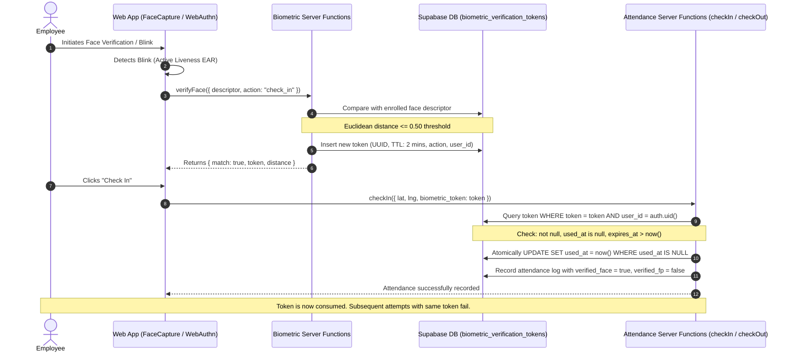

# Biometric Verification & Anti-Spoofing Architecture

## 1. Executive Summary

This document outlines the security architecture implemented in the INT HR application to eliminate client-side biometric verification bypasses, prevent token replay attacks, and introduce active facial liveness detection (anti-spoofing).

### Vulnerabilities Resolved
1. **Attendance Verification Bypass (Critical)**:
   - *Previous state*: The check-in and check-out endpoints trusted client-supplied flags (`biometric_method: "face"`, `biometric_distance: 0.12`). Any malicious client or browser console command could claim biometric verification without performing actual face recognition or fingerprint validation.
   - *Fix*: Introduced a cryptographically random, short-lived single-use verification token (`biometric_verification_tokens`), atomically validated and consumed by the backend. The server ignores client-claimed flags and derives the verification state directly from the database token.

2. **Face Descriptor & Verification Replay Attacks**:
   - *Previous state*: Biometric results had no temporal or single-use boundaries.
   - *Fix*: Tokens have a strict 2-minute Time-To-Live (TTL), are bound to the specific authenticated `user_id` and action (`check_in`, `check_out`, or `attendance`), and are atomically marked `used_at = now()` upon first check-in/out attempt. Any replay attempt is immediately blocked with reason `biometric_replayed`.

3. **Presentation & Static Photo Spoofing**:
   - *Previous state*: `FaceCapture.tsx` allowed a single static snapshot capture. An attacker could hold a printed photograph or digital picture up to the webcam.
   - *Fix*: Implemented real-time **Eye Aspect Ratio (EAR)** active liveness detection using `faceLandmark68Net` landmarks. The system actively monitors human eye closure and reopening dynamics within realistic physiological timing (70ms–950ms) before automatically confirming liveness and extracting descriptors.

---

## 2. Server-Side Biometric Token Architecture

### 2.1 Database Schema (`public.biometric_verification_tokens`)

```sql
CREATE TABLE IF NOT EXISTS public.biometric_verification_tokens (
  id uuid PRIMARY KEY DEFAULT gen_random_uuid(),
  user_id uuid NOT NULL REFERENCES auth.users(id) ON DELETE CASCADE,
  token text NOT NULL UNIQUE,
  action text NOT NULL DEFAULT 'attendance', -- 'check_in', 'check_out', or 'attendance'
  method text NOT NULL DEFAULT 'face',       -- 'face' or 'fingerprint'
  distance double precision,
  expires_at timestamptz NOT NULL,
  used_at timestamptz,
  created_at timestamptz NOT NULL DEFAULT now()
);

-- Indexes for ultra-fast lookup & atomic update:
CREATE UNIQUE INDEX IF NOT EXISTS idx_bio_tokens_token ON public.biometric_verification_tokens (token);
CREATE INDEX IF NOT EXISTS idx_bio_tokens_user_action ON public.biometric_verification_tokens (user_id, action, expires_at);

-- Row Level Security:
ALTER TABLE public.biometric_verification_tokens ENABLE ROW LEVEL SECURITY;

CREATE POLICY "Users can manage own verification tokens"
  ON public.biometric_verification_tokens
  FOR ALL
  TO authenticated
  USING (auth.uid() = user_id)
  WITH CHECK (auth.uid() = user_id);
```

### 2.2 Token Lifecycle & Verification Flow



### 2.3 Backend Atomic Validation (`validateAndConsumeBioToken`)

In `src/backend/functions/attendance.functions.ts`:
- Token is verified against `auth.uid()`.
- Validates expiration (`Date.now() < tokenRow.expires_at`).
- Validates replay (`tokenRow.used_at === null`).
- Validates action matching (`tokenRow.action === 'attendance' || tokenRow.action === action`).
- Atomically consumes token:
  ```typescript
  const { data: consumed } = await supabase
    .from("biometric_verification_tokens")
    .update({ used_at: new Date().toISOString() })
    .eq("id", tokenRow.id)
    .is("used_at", null)
    .select("id")
    .maybeSingle();

  if (!consumed) {
    return { ok: false, code: "biometric_race_replayed", reason: "Token was already consumed." };
  }
  ```
- **Untrusted client flags bypassed**: `verified_face`, `verified_fp`, and `biometric_distance` written to attendance tables are populated *exclusively* from `tokenRow.method` and `tokenRow.distance`.

---

## 3. Active Liveness Detection & Anti-Spoofing (`FaceCapture.tsx`)

### 3.1 Eye Aspect Ratio (EAR) Algorithm
Using the bundled 68-point facial landmarks (`faceLandmark68Net`):
- Left eye landmark points: 36 to 41
- Right eye landmark points: 42 to 47

$$\text{EAR} = \frac{\|p_1 - p_5\| + \|p_2 - p_4\|}{2 \cdot \|p_0 - p_3\|}$$

Where:
- $p_0, p_3$ are outer and inner horizontal eye corners.
- $p_1, p_5$ and $p_2, p_4$ are vertical eyelid landmarks.

### 3.2 Human Blink State Machine
```
[ searching ]
     │ (Face detected + EAR >= 0.22)
     ▼
[ face_ready ]  <── "Please blink naturally..."
     │ (Eyes close: EAR <= 0.185)
     ▼
[ blink_down ]  <── Timestamp recorded
     │ (Eyes reopen: EAR >= 0.22 within 70ms - 950ms)
     ▼
[ liveness_verified ]
     │ (Auto-trigger capture)
     ▼
[ processing ]  <── Extracts 128-d descriptor from live frame
```

### 3.3 Protection Against Spoofing Attacks
1. **Printed Photo Attacks**: Static paper exhibits zero EAR change; state machine remains at `face_ready` waiting for eye closure, preventing verification.
2. **Recorded Video Replays (without natural blink dynamics)**: Rapid looping or static playback fails physiological blink duration requirements (70ms–950ms window).
3. **Descriptor & Network Interception**: Descriptors are transmitted over HTTPS; tokens expire after 120 seconds and cannot be reused.
4. **Privacy Preservation**: No employee selfie pictures are stored to disk or database during attendance. Only mathematical vector descriptors (128 floats) and single-use ephemeral tokens are processed.
