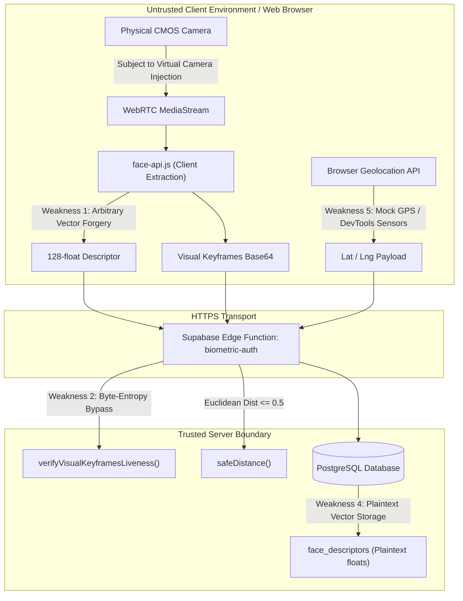

# Biometric Face Verification & Attendance Security Assessment
**Document Version:** 1.0.0  
**Target Architecture:** INT-HR Mobile & Web SPA Attendance Subsystem (`FaceChallengeCapture.tsx`, `biometric-challenge.ts`, `biometric-auth` Edge Function)  
**Standard Frameworks:** NIST SP 800-63B (Identity Proofing & Authenticator Assurance), ISO/IEC 30107-3 (Biometric Presentation Attack Detection), OWASP API Security Top 10  

---

## 1. Executive Summary

This security assessment evaluates the threat model and vulnerability posture of the facial verification and biometric challenge system in the INT-HR attendance application.

### Current Strengths:
* **Server-Issued Cryptographic Nonces:** The server issues an unpredictable random sequence of poses (`expected_sequence`) with a short time-to-live (45s TTL) that burns upon single use or failed attempts.
* **Database Proof Token Minting:** Verification proofs (`vp_...`) are cryptographically hashed using SHA-256 before being committed to PostgreSQL via atomic stored procedures (`mint_biometric_proof`).
* **Rate-Limiting & Attempt Throttling:** Strict atomic throttling (`record_challenge_failure`) revokes challenges after repeated mismatches.

### Core Threat Reality:
Because verification runs primarily within an open single-page web application (SPA) executing on client devices, **any computation, validation, or telemetry gathered inside the browser exists outside the trusted security boundary**. An adversary with control over their client environment (browser DevTools, virtual cameras, proxy tools, or modified scripts) can exploit structural architectural gaps unless mitigated.

---

## 2. In-Depth Vulnerability Analysis



---

###  Weakness 1: Client-Side Descriptor Extraction (Untrusted Input Boundary)
* **Severity:** **High / Critical**
* **Vulnerable Files:** [`src/components/biometrics/FaceChallengeCapture.tsx`](file:///d:/int/int-hr-app2/src/components/biometrics/FaceChallengeCapture.tsx), [`src/lib/biometric-challenge.ts`](file:///d:/int/int-hr-app2/src/lib/biometric-challenge.ts#L38)
* **Mechanics:**  
  The 128-dimensional floating point vector (`descriptor`) representing the face embedding is calculated by `face-api.js` on the employee's machine and sent via JSON payload to `verify-face`.
* **Exploitation Vector:**  
  An attacker does not need to bring a friend's face or even activate a camera. If an employee obtains their legitimate 128-float vector (e.g., from browser memory, a prior network trace, or a compromised database record), they can use a script or HTTP proxy (Burp Suite, Charles) to POST the vector directly to `verify-face`.
* **Root Cause:**  
  The backend does not compute face embeddings; it simply trusts the client-provided vector and computes Euclidean distance against `face_descriptors.descriptor`.

---

###  Weakness 2: Compressed-Byte Heuristic Liveness Detection (PAD Bypass)
* **Severity:** **High**
* **Vulnerable Files:** [`supabase/functions/biometric-auth/index.ts`](file:///d:/int/int-hr-app2/supabase/functions/biometric-auth/index.ts#L206-L226)
* **Mechanics:**  
  The server attempts to prevent presentation replay attacks by inspecting the first 8192 bytes of consecutive keyframe images:
  ```ts
  const sampleLen = Math.min(a.length, b.length, 8192);
  let diff = 0;
  for (let k = 0; k < sampleLen; k++) {
    if (Math.abs(a[k] - b[k]) > 12) diff++;
  }
  const diffRatio = diff / sampleLen;
  if (diffRatio < 0.05) { staticCount++; }
  ```
* **Exploitation Vector:**  
  1. **Inspection of Compressed File Bytes:** The difference is calculated on raw JPEG/PNG container bytes, not decoded RGB raster pixels. Variable JPEG compression headers, slight ambient luminance shifts, or metadata timestamps produce differences `> 12` on static photos.
  2. **Zero Server-Side Pose Verification:** The server verifies that the client declared step strings matching `expected_sequence` (e.g. `turn_left`, `blink`), but **no computer vision runs on the server** to confirm the head actually turned left or the eyelids closed. An attacker can supply photos of anything with slight noise.

---

###  Weakness 3: Virtual Camera & WebRTC Stream Injection
* **Severity:** **High**
* **Vulnerable Files:** `navigator.mediaDevices.getUserMedia` in browser environment
* **Mechanics:**  
  Web browsers treat any registered DirectShow/MediaFoundation video source as a legitimate camera.
* **Exploitation Vector:**  
  * An employee installs OBS Virtual Camera, ManyCam, or a headless Chrome browser extension that overrides `getUserMedia`.
  * The employee feeds a recorded 5-second video clip of themselves (or a synthetic deepfake) performing poses.
  * The client-side landmark detector evaluates the injected video, passes all pose steps, computes the genuine descriptor, and signs off on verification.

---

###  Weakness 4: Plaintext 128-Vector Biometric Template Storage (Non-Cancelable Biometrics)
* **Severity:** **Medium**
* **Vulnerable Files:** Database table `face_descriptors.descriptor`
* **Mechanics:**  
  Enrolled facial feature embeddings are stored as raw Euclidean floating-point arrays `float8[]` in PostgreSQL.
* **Exploitation Vector:**  
  Biometric vectors are permanent identifiers. Unlike passwords or session tokens, human faces cannot be reset or rotated. If database backups or API endpoints leak the raw descriptors, an employee's biometric identity is permanently exposed.
* **Countermeasure:**  
  Employ cancelable biometrics (Biohashing, homomorphic distance encryption, or salted projection transformations) so compromised embeddings cannot be reverse-engineered or cross-matched.

---

###  Weakness 5: Browser Geolocation Spoofing (Mock GPS)
* **Severity:** **Medium**
* **Vulnerable Files:** [`src/lib/biometric-challenge.ts`](file:///d:/int/int-hr-app2/src/lib/biometric-challenge.ts#L63-L71)
* **Mechanics:**  
  The client collects GPS coordinates via `navigator.geolocation.getCurrentPosition()` and attaches them to `commit-attendance`.
* **Exploitation Vector:**  
  Chrome DevTools allows setting arbitrary coordinates in the **Sensors** panel. On Android, "Fake GPS" applications easily spoof location unless root/mock-provider flags are actively checked by native code.

---

###  Weakness 6: Soft Cryptographic Device Binding Fallback
* **Severity:** **Medium**
* **Vulnerable Files:** [`supabase/functions/biometric-auth/index.ts`](file:///d:/int/int-hr-app2/supabase/functions/biometric-auth/index.ts#L569-L577)
* **Mechanics:**  
  ```ts
  if (devRow?.public_key) {
    if (!deviceSignature) {
      return json(403, { code: "DEVICE_SIGNATURE_REQUIRED" });
    }
    // verify signature
  }
  ```
* **Exploitation Vector:**  
  If a user registers a browser session where `public_key` is null (or manipulates device registration parameters), the cryptographic possession check is skipped entirely, allowing arbitrary machines to commit attendance.

---

## 3. Attack Scenarios Matrix

| Threat Actor | Objective | Method | Likelihood | Impact |
| :--- | :--- | :--- | :--- | :--- |
| **Dishonest Employee** | Check in from home without being present at office | Uses Chrome DevTools Sensors (fake GPS) + OBS Virtual Camera playing recorded morning video | **High** | Payroll fraud / false presence |
| **Colluding Coworker** | Clock in on behalf of absent friend | Submits the absent friend's known descriptor vector via scripted POST request | **Medium** | Time-theft / audit evasion |
| **Malicious Insider / Attacker** | Harvest employee biometric signatures | Accesses unencrypted `face_descriptors` table via SQL injection or leaked database credentials | **Low** | Permanent PII / biometric compromise |

---

## 4. Remediation & Hardening Roadmap

### Phase 1: Immediate Mitigations (P0 - Quick Wins)
1. **Virtual Camera Blacklist:**
   Inspect `mediaStreamTrack.label` and `navigator.mediaDevices.enumerateDevices()`. Block devices with labels containing `OBS`, `Virtual`, `v4l2`, `ManyCam`, `Fake`, or `Screen`.
2. **Strict Hardware Key Requirement:**
   Enforce `devRow.public_key != null` in `commit-attendance`. Reject any request from devices without an enrolled cryptographic keypair.
3. **True Pixel-Level Diff on Server:**
   Decode image frames on the server and calculate Structural Similarity Index (SSIM) or mean squared error (MSE) across decoded luminance channels instead of compressed byte buffers.

### Phase 2: Medium-Term Hardening (P1 - Robust Security)
1. **Server-Side Inference:**
   Shift facial feature extraction to the server side. The browser sends encrypted, timestamped image crops, and a backend inference service extracts descriptors and calculates pose angles.
2. **WebAuthn / FIDO2 Biometric Binding:**
   Require a WebAuthn user-verification assertion (Touch ID / Windows Hello / Face Unlock) alongside the face scan. This locks execution to hardware-attested Secure Enclaves.

### Phase 3: Long-Term Enterprise Architecture (P2)
1. **Cancelable Biometric Embeddings:**
   Hash or transform face vectors with user-specific salt matrices before storage.
2. **Multi-Signal Context Verification:**
   Cross-verify client GPS with Edge IP geolocation (MaxMind / Cloudflare headers) and office Wi-Fi BSSID to detect location spoofing automatically.

