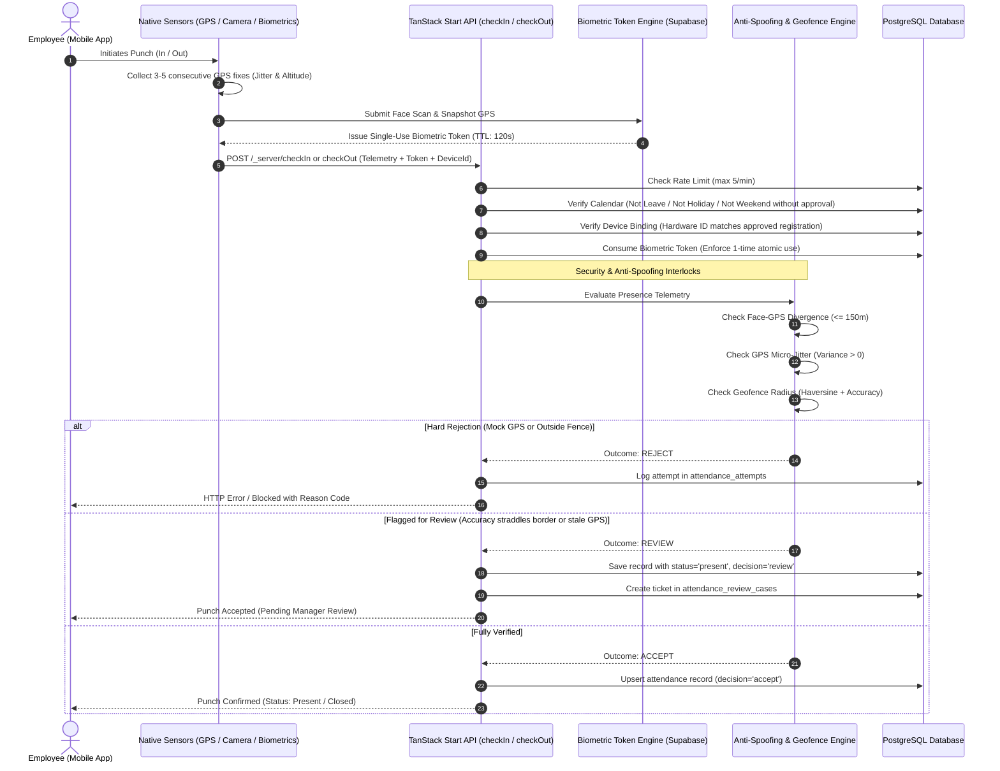

# INT HR Native Mobile Developer Integration Guide: Check-In & Check-Out Engine

> **Document Version:** 2.0.0  
> **Audience:** iOS (Swift), Android (Kotlin), Flutter, and React Native Engineers  
> **Architecture:** Zero-Trust Presence & Biometric Telemetry Verification  
> **Last Updated:** November 2026

---

## 1. Executive Summary & Architecture

The INT HR attendance engine does not rely solely on raw GPS coordinates. Because software spoofing, fake GPS apps, and replay attacks are prevalent on mobile devices, the system enforces a **Zero-Trust, 4-Stage Multi-Factor Verification Pipeline** executed directly on the server:



---

## 2. The 4 Security Pillars

Your mobile implementation **must collect and submit all required signals** to pass server-side gates:

### Pillar 1: Pre-Flight & Business Logic Gates
1. **Rate Limiting:** Maximum 5 punch requests per 60-second window. Exceeding triggers `rate_limited` with `retryAfterSeconds`.
2. **One Punch Per Day Rule:**
   - `checkIn`: Fails with `check_in_already` if an `in_time` already exists for today.
   - `checkOut`: Fails with `check_out_not_in` if no `in_time` exists, or `check_out_already` if `out_time` is already recorded.
3. **Operational Interlocks (Check-Out Only):**
   - **Active Tasks:** If an employee has any task where `status == "in_progress"`, check-out is blocked (`active_task_in_progress`). The app must prompt the user to complete or close the task first.
   - **Active Travel:** If the employee has an open travel session (`kind == "start_trip"`), check-out is blocked (`active_travel_in_progress`).
4. **Calendar Validation:**
   - Blocked on approved leaves (`leave`), official holidays (`holiday`), or weekends (`weekend`) unless the profile has `approved_work_date == today`.

### Pillar 2: Hardware Device Binding (`device_id`)
When the organization enables device binding for an employee (`profiles.device_check_required == true`):
- The app must send a persistent hardware identifier in `device_id`.
- The device must be previously registered and in `"approved"` status in `employee_devices`.
- If an unrecognized device is used, the call fails with `device_unauthorized`.

### Pillar 3: Biometric Verification Token (`biometric_token`)
- If the employee profile has `face_required == true`, raw check-in/out **will be rejected** unless accompanied by a verified `biometric_token`.
- The token is acquired by calling the server's `verifyFace` endpoint or the Edge Function `biometric-auth`.
- **Token Characteristics:**
  - Token lifetime: **120 seconds** (2 minutes).
  - Single-use: The server atomically marks `used_at = now()` upon punch submission. Any replay attempt triggers `biometric_replayed`.
  - Cryptographic GPS snapshot: The token stores the GPS coordinates at the moment the camera captured the face.

### Pillar 4: Anti-Spoofing & Geofence Telemetry (`evaluatePresence`)
Mobile apps must send an array of continuous GPS fixes (`samples`) and sensor telemetry. The server runs the following algorithms:
1. **Face-Location Divergence:** The distance between the GPS coordinates captured during the face scan and the GPS coordinates sent in the punch payload cannot exceed **150 meters**. If greater, it is rejected with `geo_face_discrepancy`.
2. **Mock GPS Micro-Jitter Analysis:** Real satellite GPS always displays slight sensor drift across consecutive readings. If `samples` (minimum 3 readings) displays **exact zero variance** (`latVariance === 0 && lngVariance === 0`), it is flagged as a synthetic mock location app and rejected with `mock_gps_detected`.
3. **Altitude Check:** Real GPS returns an altitude reading. An exact `0.0` altitude is flagged as suspicious (`suspicious_zero_altitude`) and sent to manual manager review.
4. **GPS Age:** Telemetry older than 30 seconds is marked as stale (`gps_stale`) and flagged for review.
5. **Geofence Haversine Radius:**
   - Distance + GPS accuracy $\le$ Radius $\rightarrow$ **Accepted**.
   - Distance $-$ GPS accuracy $>$ Radius $\rightarrow$ **Hard Reject** (`gps_outside_fence`).
   - Accuracy circle straddles fence edge $\rightarrow$ **Flagged for Review** (`gps_boundary_uncertain`).

---

## 3. Endpoints & API Contracts

All endpoints are hosted on the application base URL and invoked as TanStack Start RPC functions:
- **Protocol:** `POST`
- **Headers:**
  ```http
  Content-Type: application/json
  Authorization: Bearer <USER_SUPABASE_JWT_TOKEN>
  ```
- **Envelope:** The body must be wrapped in `{ "data": { ... } }`.

---

### 3.1 Step 1: Pre-Check Employee Gates (`listMyAccess`)
Call before rendering the Punch button to know what sensors to activate:

**Endpoint:** `POST {{base_url}}/_server/listMyAccess`

**Request Body:**
```json
{
  "data": {}
}
```

**Response (`200 OK`):**
```json
{
  "fences": [
    {
      "id": "e2f1c080-...",
      "name": "Cairo HQ Campus",
      "lat": 30.0444,
      "lng": 31.2357,
      "radius_m": 150
    }
  ],
  "networks": [
    {
      "id": "n8b3...",
      "ssid": "INT-CORP-SECURE",
      "bssid": null
    }
  ],
  "face_required": true,
  "device_check_required": true,
  "today_status": {
    "checked_in": false,
    "checked_out": false,
    "in_time": null,
    "out_time": null
  }
}
```

---

### 3.2 Step 2: Biometric Verification & Token Issuance (`verifyFace`)
Required when `face_required == true`. Capture a selfie, extract the 128-d Float32 descriptor using mobile ML models (e.g., MobileFaceNet / TFLite / MLKit), and verify against the server.

**Endpoint:** `POST {{base_url}}/_server/verifyFace`

**Request Body:**
```json
{
  "data": {
    "descriptor": [0.0451, -0.1284, 0.0931, ..., 0.0122], // Exactly 128 floats
    "action": "check_in", // or "check_out"
    "snapshot_lat": 30.0445,
    "snapshot_lng": 31.2358,
    "snapshot_accuracy_m": 8.5
  }
}
```

**Response (`200 OK`):**
```json
{
  "match": true,
  "enrolled": true,
  "distance": 0.284,
  "token": "d7a4f910-1c23-4567-89ab-cdef01234567"
}
```
> [!IMPORTANT]
> Save the `token` from this response. You must pass it into the `checkIn` or `checkOut` payload within **120 seconds**.

---

### 3.3 Step 3: Punch Check-In (`checkIn`)

**Endpoint:** `POST {{base_url}}/_server/checkIn`

**Request Body Schema:**
```json
{
  "data": {
    "lat": 30.04445,
    "lng": 31.23572,
    "accuracy_m": 7.2,
    "gps_age_ms": 420,
    "gps_sample_count": 5,
    "samples": [
      { "lat": 30.04444, "lng": 31.23571, "accuracy_m": 8.0, "timestamp": 1730554000100 },
      { "lat": 30.04445, "lng": 31.23572, "accuracy_m": 7.5, "timestamp": 1730554000600 },
      { "lat": 30.04446, "lng": 31.23573, "accuracy_m": 7.2, "timestamp": 1730554001100 }
    ],
    "altitude": 32.4,
    "altitude_accuracy": 3.0,
    "heading": 182.5,
    "speed": 0.0,
    "device_id": "a1b2c3d4-e5f6-7890-abcd-ef1234567890",
    "biometric_token": "d7a4f910-1c23-4567-89ab-cdef01234567",
    "biometric_method": "face",
    "ssid": "INT-CORP-SECURE",
    "branch": "Cairo HQ",
    "note": ""
  }
}
```

**Field Descriptions:**

| Field | Type | Mandatory? | Description |
|---|---|:---:|---|
| `lat` | Float | **Yes** | Latitude of user's final GPS fix (-90.0 to 90.0). |
| `lng` | Float | **Yes** | Longitude of user's final GPS fix (-180.0 to 180.0). |
| `accuracy_m` | Float | **Yes** | Reported horizontal accuracy radius in meters from GPS provider. |
| `gps_age_ms` | Integer | Recommended | Elapsed time in ms between coordinate acquisition and API call (`Date.now() - timestamp`). |
| `gps_sample_count` | Integer | Recommended | Number of continuous GPS readings taken before submission (e.g. `3` to `5`). |
| `samples` | Array | **Required for Anti-Spoofing** | Array of at least 3 consecutive coordinate fixes with slight micro-jitter to disprove mock GPS. |
| `altitude` | Float | Recommended | Sensor altitude in meters above sea level. |
| `device_id` | String | **Required if bound** | Hardware UUID stored in Keychain/KeyStore. |
| `biometric_token` | String | **Required if face on** | Single-use UUID returned from Step 2. |
| `biometric_method` | String | Optional | `"face"` or `"fingerprint"`. |
| `ssid` | String | Optional | Connected Wi-Fi SSID (advisory check). |
| `branch` | String | Optional | Selected branch or site name. |
| `note` | String | Optional | User note (max 500 chars). |

---

### 3.4 Step 4: Punch Check-Out (`checkOut`)

**Endpoint:** `POST {{base_url}}/_server/checkOut`

**Request Body Schema:**
Identical to `checkIn`. Include current GPS coordinates, samples, `device_id`, and a fresh `biometric_token`.

---

## 4. Response Structures & Handling

### 4.1 Success Response (`200 OK`)

```json
{
  "ok": true,
  "blocked": false,
  "decision": "accept", // "accept" or "review"
  "pending_review": false,
  "risk_signals": []
}
```

- When `decision === "accept"`: The punch is officially recorded and confirmed. Show a green checkmark screen.
- When `decision === "review"` (e.g. boundary uncertain): The punch was recorded, but flagged for administrative confirmation. Show an informative badge: *"Check-in recorded, pending supervisor review."*

### 4.2 Blocked / Rejected Response (`200 OK` with `blocked: true` or `400/403`)

The server returns a structured blocking response:

```json
{
  "ok": false,
  "blocked": true,
  "code": "gps_outside_fence",
  "reason": "Check-in blocked · you are 340m away from Cairo HQ Campus (allowed radius: 150m).",
  "params": {
    "distance": 340,
    "radius": 150,
    "fenceName": "Cairo HQ Campus"
  }
}
```

---

## 5. Standard Error Codes Reference

Your native app must catch these error codes and display appropriate UI workflows:

| Error Code | Root Cause | Native Mobile Action / UI Feedback |
|---|---|---|
| `rate_limited` | Exceeded 5 punches within 60 seconds. | Show countdown timer: *"Too many attempts. Please wait X seconds."* |
| `check_in_already` | Already checked in today. | Disable check-in button; show current punch in-time. |
| `check_out_not_in` | Attempting check-out without check-in. | Show alert: *"You must check in first before checking out."* |
| `check_out_already` | Already checked out today. | Disable check-out button; day is marked completed. |
| `active_task_in_progress` | Employee has open tasks. | Show popup with task title: *"Please complete or transfer task '[Title]' before checking out."* |
| `active_travel_in_progress` | Active travel mode is ongoing. | Prompt employee to complete travel session before checkout. |
| `device_unauthorized` | Hardware ID not recognized or pending. | Redirect to *"Register This Device"* screen or contact HR. |
| `face_required` | No biometric token attached. | Open native camera face scanner flow. |
| `biometric_invalid` | Token does not exist. | Re-prompt face scan. |
| `biometric_expired` | Token older than 120 seconds. | Re-prompt face scan: *"Biometric session expired. Please scan again."* |
| `biometric_replayed` | Token was already used once. | Discard cached token and trigger a fresh scan. |
| `geo_face_discrepancy` | Face scanned >150m away from GPS. | Security alert: *"Location moved significantly during verification. Please scan again on site."* |
| `mock_gps_detected` | Zero coordinate variance across 3 samples. | Security rejection: *"Fake GPS / Mock Location detected. Disable mock locations in developer settings."* |
| `gps_outside_fence` | User is outside all assigned perimeters. | Show map with nearest perimeter and distance away. |
| `leave` | Today is an approved leave day. | Display leave details: *"Today is scheduled as Annual Leave."* |
| `holiday` | Today is an official public holiday. | Display holiday banner. |
| `weekend` | Non-working weekend day (Friday/Saturday). | Inform user: *"Weekend - not scheduled to work today."* |
| `attendance_restricted` | 3+ mock GPS attempts in last 2 hours. | Lock button: *"Operations restricted. Please contact HR administration."* |

---

## 6. Native Implementation Best Practices

### A. Collecting High-Integrity GPS Samples

```
1. Request High-Accuracy GPS permissions:
   - iOS: kCLLocationAccuracyBestForNavigation
   - Android: Priority.PRIORITY_HIGH_ACCURACY
2. Do NOT use cached last-known location (frequently stale by hours).
3. Start location updates and collect 3 to 5 distinct updates over 1.5 - 2.5 seconds.
4. Verify accuracy <= 20 meters before sending. If accuracy is poor (e.g. 150m indoors), prompt user to move closer to a window or connect to office Wi-Fi.
5. Populate the `samples` array with the collected timestamps and coordinates.
```

### B. Persistent Hardware Device ID Generation

- **iOS (Swift):**
  Use `UIDevice.current.identifierForVendor!.uuidString` and store it securely in the **iOS Keychain** with `kSecAttrAccessibleAfterFirstUnlockThisDeviceOnly`. This ensures the UUID survives app uninstalls and cannot be restored onto another device via iCloud backup.
- **Android (Kotlin):**
  Generate a persistent UUID stored in `EncryptedSharedPreferences` backed by the **Android KeyStore** system. Complement with `Settings.Secure.getString(contentResolver, Settings.Secure.ANDROID_ID)`.

### C. Timing & Sequence

```
1. [User taps "Punch In"]
2. Collect GPS Telemetry (1.5 seconds) -> Lock coordinates (Lat, Lng, Accuracy, Samples).
3. If face required:
   - Open front camera -> Capture face frame.
   - Run liveness (blink / head turn) & extract 128-d vector.
   - Send `verifyFace` with descriptor + snapshot coordinates.
   - Receive `token`.
4. Immediately submit `checkIn` payload with coordinates + token + deviceId.
5. Receive server response -> Display confirmation.
```

---

## 7. Postman Testing Reference

To test these exact payloads directly without mobile hardware, refer to the pre-configured requests in:
- [`.plans/INT_HR_Postman_Collection.json`](file:///d:/int/int-hr-app2/.plans/INT_HR_Postman_Collection.json)
  - Folder: **`6. Attendance & Punch Tracking`**
  - Folder: **`7. Biometrics, WebAuthn & Physical Terminals`**
  - Folder: **`11. Devices, Networks & Hardware Security`**
